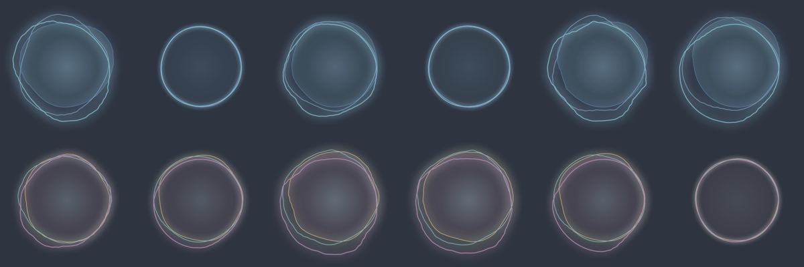

# Phonon demo (macOS 15+)

SwiftUI app for Gradium's Phonon 31m on the Neural Engine (`PocketTtsSmallManager(model: .phonon31m)`).
It speaks through a ring that listens to itself.



## The ring

- **At rest** it breathes: a soft circle with a slow pulse.
- **While speaking**, three closed waves follow the live spectrum of what the speaker plays. An audio tap
  on the player node analyses every 20 ms block into 24 log-spaced bands from 90 Hz to 9 kHz. The bands are
  mirrored around the circle, low frequencies at the top and high at the bottom, so vowels swell the upper
  arcs and sibilants push the lower ones. Each wave spins at its own speed, so a held vowel keeps moving.
- It follows playback, not the generator, which runs about 20x ahead of real time.
- Regular voices are drawn in Nord frost blues. The character voices, a pirate, a dragon, the Snow Queen and
  so on, switch the ring to aurora colours.

## Controls

- **Voice chips.** Six featured English voices plus the checkpoint default, and six characters. **More**
  lists the other English voices. A voice is prefilled the first time it speaks and cached after that.
- **Text box and presets.** Hello, Numbers ($42.50, an email, a URL, 24/7), Pauses and Story. Text goes
  through Gradium's normalizer before tokenizing.
- **Speak / Stop** (⌘↩).
- **Stats line**: time to first audio, ms per 80 ms frame, real-time factor and model load time.

## Run

```bash
cd Examples/PhononDemo
swift run -c release PhononDemo
```

The first launch downloads the pack (about 171 MB) from `FluidInference/pocket-tts-coreml`
`phonon/phonon-31m-en` and compiles it for the Neural Engine. Later launches load in about 0.1 s.

Launch flags:

| Flag | Effect |
|---|---|
| `--voice en_gb_Maeve` | start with this voice |
| `--text "…"` | start with this text |
| `--autorun` | speak on launch |
| `--mute` | play silently; the ring still moves |
| `--no-audio` | no playback at all |
| `--mimi fp16-fused` | fused fp16 decoder: faster, with an audible hiss in pauses |
| `--render <dir>` | synthesize the text offline, write ring frames as PNGs every 120 ms plus `speech.wav`, then quit |

`--render` exists because macOS pauses animations in hidden windows. It also produced the image above.
